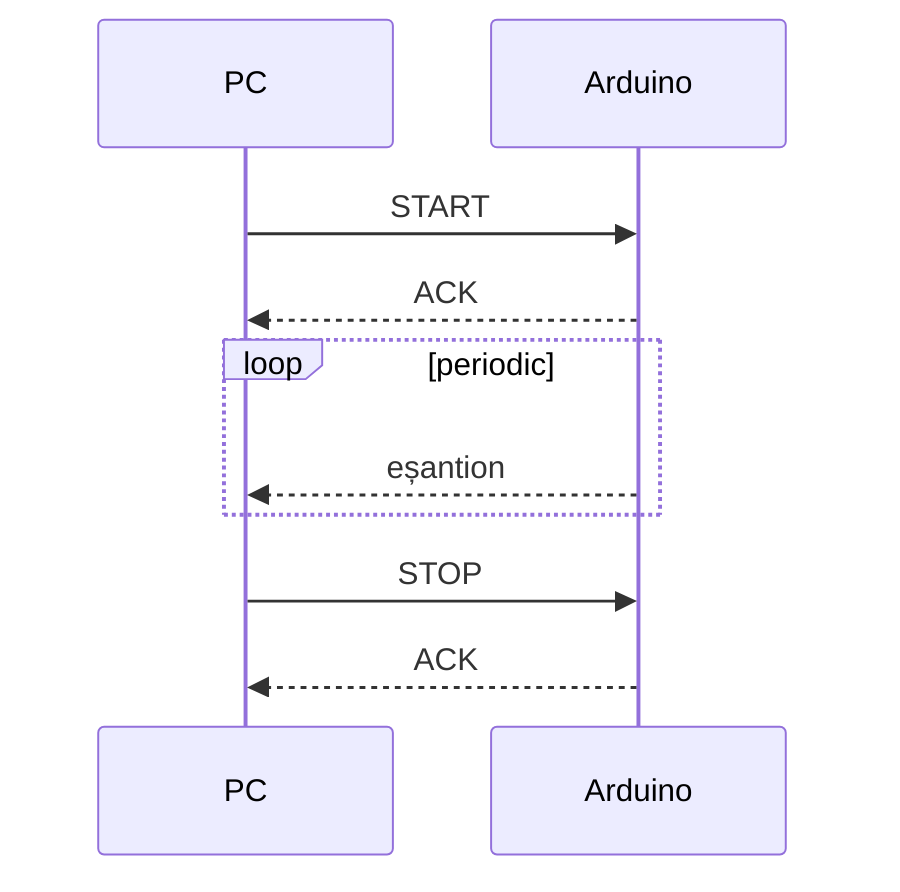
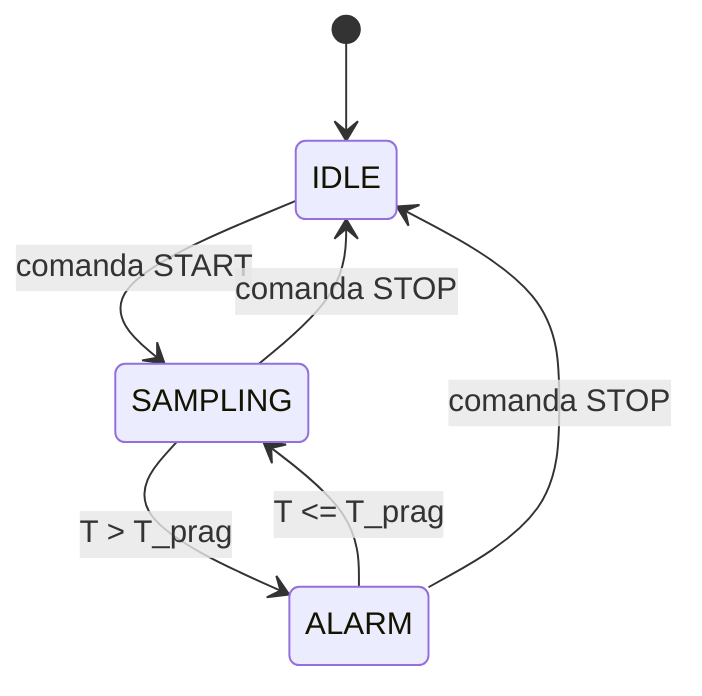

# Protocol de comunicație PC – Arduino

Acest document descrie protocolul serial dintre PC și Arduino: schimbul de mesaje, comenzile suportate și automatul de stări al achiziției.

Parametri legăturii seriale: 115200 baud, 8N1. Comenzile și răspunsurile sunt șiruri ASCII terminate cu `\n`.

## Schimbul de mesaje

PC-ul trimite comanda `START`. Arduino confirmă cu `ACK` și începe să trimită eșantioane la fiecare perioadă de eșantionare, până când primește `STOP`.

## Comenzi suportate

| Comandă  | Cod    | Efect                                                                 |
|----------|--------|-----------------------------------------------------------------------|
| `START`  | `0x01` | Pornește achiziția; Arduino răspunde `ACK` și trimite eșantioane      |
| `STOP`   | `0x02` | Oprește achiziția; Arduino răspunde `ACK` și revine în `IDLE`         |
| `STATUS` | `0x03` | Arduino răspunde cu starea curentă: `IDLE`, `SAMPLING` sau `ALARM`    |

## Automatul de achiziție

Achiziția este controlată de un automat cu trei stări. Tranzițiile depind de comenzile primite de la PC și de temperatura măsurată `T` comparată cu pragul `T_prag`.

| Stare      | Descriere                                                        |
|------------|------------------------------------------------------------------|
| `IDLE`     | Repaus: nu se efectuează eșantionare                             |
| `SAMPLING` | Eșantionare activă, la perioada configurată                      |
| `ALARM`    | Temperatura a depășit pragul; eșantionarea continuă, cu alarmă   |